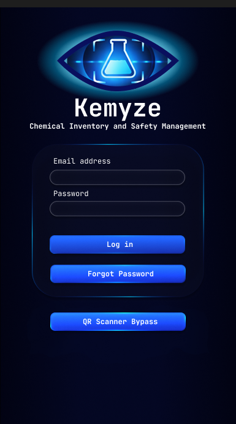
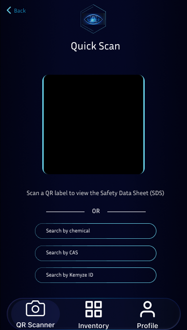
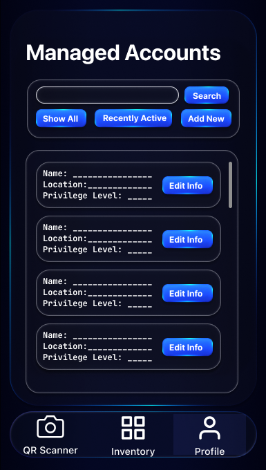
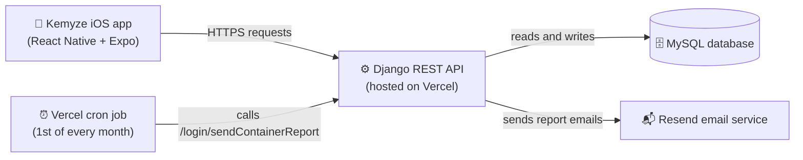
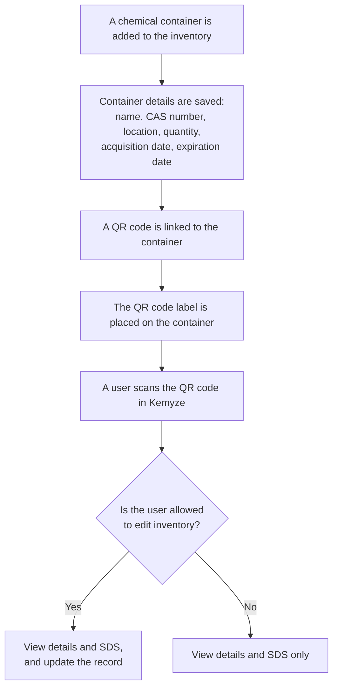
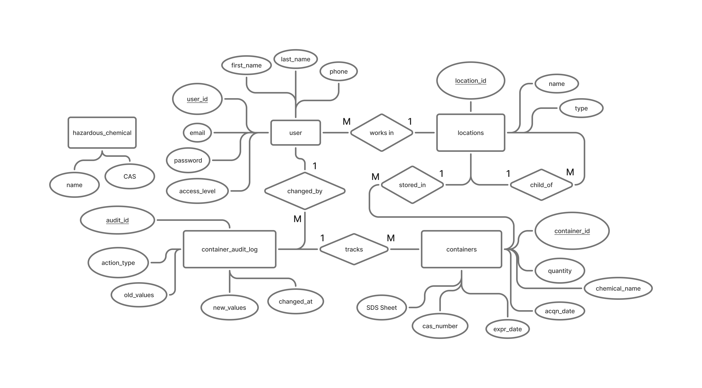
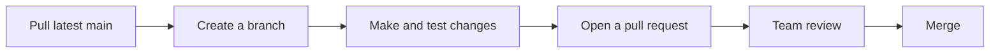

<a id="readme-top"></a>

<!-- HEADER: https://github.com/kyechan99/capsule-render -->


<div align="center">

<a href="https://github.com/gjhollmann/Kemyze">
  
</a>

<br />
<br />

[![React Native][ReactNative-shield]][ReactNative-url]
[![Expo][Expo-shield]][Expo-url]
[![Django][Django-shield]][Django-url]
[![MySQL][MySQL-shield]][MySQL-url]
[![Vercel][Vercel-shield]][Vercel-url]
[![iOS][iOS-shield]][iOS-url]
[![Jest][Jest-shield]][Jest-url]

[![Contributors][contributors-shield]][contributors-url]
[![Last commit][last-commit-shield]][last-commit-url]
[![Pull requests][pulls-shield]][pulls-url]

**Team Reverse Engineers** · CSC 190/191 Senior Project · California State University, Sacramento

</div>

<details>
  <summary><b>📑 Table of Contents</b></summary>

1. [About the Project](#-about-the-project)
2. [Key Features](#-key-features)
3. [Screenshots](#-screenshots)
4. [Built With](#-built-with)
5. [System Architecture](#-system-architecture)
6. [Application Workflow](#-application-workflow)
7. [User Roles](#-user-roles)
8. [Database Information](#-database-information)
9. [Getting Started](#-getting-started)
10. [Deployment](#-deployment)
11. [Testing](#-testing)
12. [Security Considerations](#-security-considerations)
13. [Contributing](#-contributing)
14. [Team Members](#-team-members)
15. [Academic Context](#-academic-context)
16. [Acknowledgements](#-acknowledgements)

</details>

---

## 🧪 About the Project

Kemyze is an iOS application for managing a chemical inventory. It tracks every chemical container by name, CAS number, location, quantity, and expiration date, and it controls which users can view or change those records. Each container carries a QR code label. When a user scans the label with the in-app scanner, Kemyze shows the container's information and its Safety Data Sheet (SDS), based on the permissions of the logged-in user. Administrators manage user accounts and inventory, and every user receives a monthly email report of expired, expiring, and low-supply containers.

<p align="right">(<a href="#readme-top">back to top</a>)</p>

## ✨ Key Features

| Feature | Description |
| :-- | :-- |
| 📦 **Inventory tracking** | Add, edit, and search chemical containers. |
| 📷 **QR code scanning** | Scan a container label to look it up instantly. |
| 📄 **SDS access** | Open and upload Safety Data Sheets for stored chemicals. |
| 👥 **User management** | Create, edit, search, and delete user accounts. |
| 🔐 **Role-based access** | Each role sees and changes only what it is allowed to. |
| 📍 **Location tracking** | Store containers by building, room, cabinet, and shelf. |
| ⏰ **Expiration tracking** | Flag containers that are expired or expiring soon. |
| 📉 **Low-supply visibility** | Mark containers whose quantity is low. |
| 📬 **Monthly reports** | Email each user a monthly report of expired, expiring, and low containers. |
| 🕓 **Change history** | Keep a change log for containers and users. |

<p align="right">(<a href="#readme-top">back to top</a>)</p>

## 📱 Screenshots

| Login | QR Scanner | Account Management |
| :-: | :-: | :-: |
|  |  |  |
| Users sign in with their account to see the features their role allows. | Users point the camera at a container's QR code to see its details and SDS. | Administrators create, edit, search, and remove user accounts. |

<p align="right">(<a href="#readme-top">back to top</a>)</p>

## 🛠 Built With

| Layer | Technology |
| :-- | :-- |
| **Mobile app (iOS)** | React Native, Expo, Expo Router, TypeScript |
| **Backend API** | Python, Django, Django REST Framework |
| **Database** | MySQL |
| **Email** | Resend (via `django-anymail`) |
| **Hosting** | Vercel (backend API and scheduled monthly report) |
| **Testing** | Jest, `jest-expo`, Django test runner |

<p align="right">(<a href="#readme-top">back to top</a>)</p>

## 🏗 System Architecture



<p align="right">(<a href="#readme-top">back to top</a>)</p>

## 🔄 Application Workflow

<details>
  <summary><b>🔍 View the application workflow diagram</b></summary>
<br />



</details>

<details>
  <summary><b>📬 How the monthly report sorts containers</b></summary>
<br />

On the 1st of each month, every container is checked against today's date $t$ and its expiration date $e$:

$$
\text{status} =
\begin{cases}
\text{Expired} & \text{if } e < t \\
\text{Expiring soon} & \text{if } t \le e \le t + 2\ \text{months} \\
\text{Low supply} & \text{if quantity} = \text{"low"}
\end{cases}
$$

Containers that match none of these are left out of the report.

</details>

<p align="right">(<a href="#readme-top">back to top</a>)</p>

## 👥 User Roles

| Role | What they can do |
| :-- | :-- |
| **Administrator** | Manages instructor accounts, inventory records, SDS files, and system-level information. |
| **Authorized Instructor** | Views and updates chemical container records within their assigned department. |
| **Staff User** | Views relevant chemical and SDS information based on assigned access. |
| **Guest or Student User** | Scans QR codes to view SDS and basic chemical safety information without a permanent account. |

<p align="right">(<a href="#readme-top">back to top</a>)</p>

## 🗄 Database Information

The Kemyze database stores chemical containers, users, locations, and Safety Data Sheets.

<details>
  <summary><b>View the Entity Relationship Diagram (ERD)</b></summary>
<br />



</details>

| Records stored | |
| :-- | :-- |
| Chemical container name | CAS Registry Number |
| Acquisition date | Expiration date |
| Quantity status | Building, room, cabinet, and shelf location |
| SDS document reference | User account information |
| User role and permission information | Container and user change logs |

<p align="right">(<a href="#readme-top">back to top</a>)</p>

## 🚀 Getting Started

### Prerequisites

| Tool | Used for |
| :-- | :-- |
| [Git](https://git-scm.com/) | Downloading the project |
| [Python 3](https://www.python.org/downloads/) | Running the Django backend |
| [Node.js (LTS)](https://nodejs.org/) | Running the Expo app |
| [Expo Go](https://apps.apple.com/app/expo-go/id982107779) on an iPhone, **or** Xcode's iOS Simulator on a Mac | Opening the app |

### 1. Download the project

```bash
git clone https://github.com/gjhollmann/Kemyze.git
cd Kemyze
```

<details>
  <summary><b>2. Set up and run the backend (Django)</b></summary>
<br />

Create a virtual environment and install the dependencies:

```bash
python -m venv venv
source venv/bin/activate        # Windows: venv\Scripts\activate
python -m pip install -r requirements.txt
```

Create a `.env` file in the project root (see **Environment Variables** below), then set up the database and start the server:

```bash
python manage.py migrate
python manage.py runserver
```

The API runs at `http://127.0.0.1:8000/`.

</details>

<details>
  <summary><b>3. Set up and run the iOS app (Expo)</b></summary>
<br />

```bash
cd frontEnd
npm install
npx expo start
```

- **On an iPhone:** scan the QR code in the terminal with the Camera app to open it in Expo Go.
- **On a Mac:** press `i` in the terminal to open the iOS Simulator.

The app talks to the backend at the URL in [`frontEnd/constants/api.ts`](frontEnd/constants/api.ts). To use a local backend, change `BASE_URL` to your local server address.

</details>

<details>
  <summary><b>🔑 Environment Variables</b></summary>
<br />

Add these to the `.env` file in the project root. Ask a team member for the values. **Never commit the `.env` file.**

| Variable | Purpose |
| :-- | :-- |
| `SECRET_KEY` | Django secret key |
| `DATABASE_NAME` | MySQL database name |
| `DATABASE_USER` | MySQL username |
| `DATABASE_PASSWORD` | MySQL password |
| `DATABASE_HOST` | MySQL server address |
| `DATABASE_PORT` | MySQL port (usually `3306`) |
| `RESEND_API_KEY` | API key for sending report and password emails |

</details>

<details>
  <summary><b>🤖 AI coding assistant (optional)</b></summary>
<br />

Anyone who wants to use Cline in VS Code with Google Gemini can follow [CLINE_SETUP.md](CLINE_SETUP.md). The rules, skills, workflows, and hooks in `.clinerules/` and `.cline/skills/` are read only by Cline and do not change the app.

</details>

<p align="right">(<a href="#readme-top">back to top</a>)</p>

## ☁️ Deployment

| Part | Where it runs | How |
| :-- | :-- | :-- |
| **Backend API** | Vercel — [kemyze-one.vercel.app](https://kemyze-one.vercel.app/) | Vercel runs [`build_files.sh`](build_files.sh) to install dependencies and apply migrations. |
| **Monthly report** | Vercel cron job | [`vercel.json`](vercel.json) calls `/login/sendContainerReport` at midnight on the 1st of each month. |
| **iOS app** | iPhone | Built with Expo from the [`frontEnd/`](frontEnd/) folder (bundle ID `com.gjhollmann.frontEnd`). |

<details>
  <summary><b>Deploy the backend to your own Vercel project</b></summary>
<br />

1. Import the GitHub repository into [Vercel](https://vercel.com/new).
2. Add every variable from **Environment Variables** in the Vercel project settings.
3. Deploy. Then set `BASE_URL` in [`frontEnd/constants/api.ts`](frontEnd/constants/api.ts) to your new Vercel URL.

</details>

<p align="right">(<a href="#readme-top">back to top</a>)</p>

## ✅ Testing

| Test suite | Location | Command |
| :-- | :-- | :-- |
| **Frontend unit tests** (Jest) | [`frontEnd/src/__tests__/`](frontEnd/src/__tests__/) | `cd frontEnd` → `npm test` |
| **Backend unit tests** (Django) | `login/`, `containers/`, `common/`, `tester/` | `python manage.py test` |
| **Acceptance tests** (system tests) | [`frontEnd/acceptance/`](frontEnd/acceptance/) | `cd frontEnd` → `npm run tester` |

<details>
  <summary><b>What the frontend unit tests cover</b></summary>
<br />

| Test file | Screen |
| :-- | :-- |
| `index.test.tsx` | Login |
| `scanner.test.tsx` | QR scanner |
| `inventory.test.tsx` | Inventory |
| `add_container.test.tsx` | Add container |
| `edit_container.test.tsx` | Edit container |
| `createprofile.test.tsx` | Create profile |
| `editprofile.test.tsx` | Edit profile |
| `quaternaryprofile.test.tsx` | Profile |
| `src/utils/handleLogin.test.ts` | Login logic |

</details>

<details>
  <summary><b>How to run an acceptance test</b></summary>
<br />

Acceptance tests use two people: a **Tester** who runs the test and a **Recorder** who watches and records the result.

| Role | Command (from `frontEnd/`) |
| :-- | :-- |
| Tester | `npm run tester` |
| Recorder | `npm run record` |

Full step-by-step instructions are in [`frontEnd/acceptance/RUN-STEPS.md`](frontEnd/acceptance/RUN-STEPS.md).

</details>

<p align="right">(<a href="#readme-top">back to top</a>)</p>

## 🔒 Security Considerations

- User authentication
- Role-based access control
- Inventory editing restricted to authorized users
- Guest access kept separate from administrative access
- Protection of account information
- SDS and inventory changes limited to authorized users

<p align="right">(<a href="#readme-top">back to top</a>)</p>

## 🤝 Contributing

Team members follow the project workflow agreed upon by the development team.



- Pull the latest version of the repository before making changes.
- Create a separate branch for new work.
- Write clear commit messages.
- Test changes before submitting them.
- Don't commit unnecessary files, credentials, or local environment settings.
- Tell the team about major changes before merging.

<p align="right">(<a href="#readme-top">back to top</a>)</p>

## 👨‍💻 Team Members

<div align="center">

| | Name | GitHub | Contact |
| :-: | :-- | :-- | :-- |
|  | **George Hollmann** | [@gjhollmann](https://github.com/gjhollmann) | ghollmann@csus.edu |
|  | **Alexander Apolonio-Flores** | [@alexapolonio](https://github.com/alexapolonio) | aapolonio-flores@csus.edu |
|  | **Joshua Zamora** | [@jzamora34](https://github.com/jzamora34) | joshuazamora@csus.edu |
|  | **Reese Nelson** | [@reesen1103](https://github.com/reesen1103) | reesenelson@csus.edu |
|  | **Matthew Fronda** | [@mfronda](https://github.com/mfronda) | mfronda@csus.edu |
|  | **Eric Cheyssial** | [@echeys01](https://github.com/echeys01) | echeyssial@csus.edu |
|  | **Sarav011** | [@Sarav011](https://github.com/Sarav011) | saravjotsingh@csus.edu |

<a href="https://github.com/gjhollmann/Kemyze/graphs/contributors">
  
</a>

</div>

<p align="right">(<a href="#readme-top">back to top</a>)</p>

## 🎓 Academic Context

Kemyze is developed as part of the CSC 190/191 Senior Project sequence at California State University, Sacramento. The project gives students experience in software engineering, Agile/SCRUM development, client communication, documentation, prototyping, implementation, testing, and delivery of a working software product.

<p align="right">(<a href="#readme-top">back to top</a>)</p>

## 🙏 Acknowledgements

<details>
  <summary><b>Resources used to build this README</b></summary>
<br />

- [GitHub Docs: Basic writing and formatting syntax](https://docs.github.com/en/get-started/writing-on-github/getting-started-with-writing-and-formatting-on-github/basic-writing-and-formatting-syntax)
- [GitHub Docs: Organizing information with collapsed sections](https://docs.github.com/en/get-started/writing-on-github/working-with-advanced-formatting/organizing-information-with-collapsed-sections)
- [GitHub Docs: Organizing information with tables](https://docs.github.com/en/get-started/writing-on-github/working-with-advanced-formatting/organizing-information-with-tables)
- [GitHub Docs: Creating diagrams](https://docs.github.com/en/get-started/writing-on-github/working-with-advanced-formatting/creating-diagrams)
- [GitHub Docs: Writing mathematical expressions](https://docs.github.com/en/get-started/writing-on-github/working-with-advanced-formatting/writing-mathematical-expressions)
- [capsule-render](https://github.com/kyechan99/capsule-render)
- [Awesome GitHub Profile README](https://github.com/abhisheknaiidu/awesome-github-profile-readme)
- [Awesome README](https://github.com/matiassingers/awesome-readme)
- [GitHub Profile README Generator](https://rahuldkjain.github.io/gh-profile-readme-generator/)
- [Shields.io](https://shields.io/) and [contrib.rocks](https://contrib.rocks/)

</details>

<p align="right">(<a href="#readme-top">back to top</a>)</p>

<!-- FOOTER: https://github.com/kyechan99/capsule-render -->


<!-- MARKDOWN LINKS & IMAGES -->
[ReactNative-shield]: https://img.shields.io/badge/React_Native-20232A?style=for-the-badge&logo=react&logoColor=61DAFB
[ReactNative-url]: https://reactnative.dev/
[Expo-shield]: https://img.shields.io/badge/Expo-000020?style=for-the-badge&logo=expo&logoColor=white
[Expo-url]: https://expo.dev/
[Django-shield]: https://img.shields.io/badge/Django-092E20?style=for-the-badge&logo=django&logoColor=white
[Django-url]: https://www.djangoproject.com/
[MySQL-shield]: https://img.shields.io/badge/MySQL-4479A1?style=for-the-badge&logo=mysql&logoColor=white
[MySQL-url]: https://www.mysql.com/
[Vercel-shield]: https://img.shields.io/badge/Vercel-000000?style=for-the-badge&logo=vercel&logoColor=white
[Vercel-url]: https://vercel.com/
[iOS-shield]: https://img.shields.io/badge/iOS-000000?style=for-the-badge&logo=apple&logoColor=white
[iOS-url]: https://developer.apple.com/ios/
[Jest-shield]: https://img.shields.io/badge/Jest-C21325?style=for-the-badge&logo=jest&logoColor=white
[Jest-url]: https://jestjs.io/
[contributors-shield]: https://img.shields.io/github/contributors/gjhollmann/Kemyze?style=for-the-badge
[contributors-url]: https://github.com/gjhollmann/Kemyze/graphs/contributors
[last-commit-shield]: https://img.shields.io/github/last-commit/gjhollmann/Kemyze?style=for-the-badge
[last-commit-url]: https://github.com/gjhollmann/Kemyze/commits/main
[pulls-shield]: https://img.shields.io/github/issues-pr/gjhollmann/Kemyze?style=for-the-badge
[pulls-url]: https://github.com/gjhollmann/Kemyze/pulls
